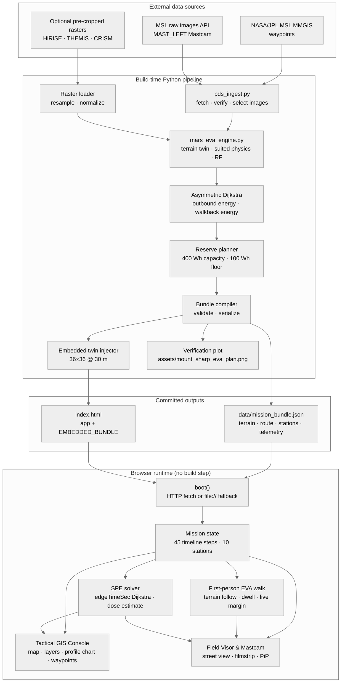

# ARES-WALK


**A Mars EVA planner that takes the walk home seriously.**

ARES-WALK plans a suited traverse across the Altadena boxwork unit on Mount Sharp. It uses real Curiosity waypoints, real Mastcam frames, a 0.38 g walking model, and a strict 25% PLSS walkback reserve.

The current plan is **646.7 m, 44.3 minutes, and 194.2 Wh**. All **10/10** stations are GO. The worst reserve margin is **+29.6 Wh**.

> **This is a prototype.** It is not a flight plan, a rover commanding product, or a medical radiation forecast.

## What you get

- A committed route, 45-step timeline, and station telemetry for the Altadena boxwork.
- A **Tactical GIS Console** with a pan/zoom terrain map, layer toggles, station cards, Mastcam thumbnails, profile chart, scrubber, and custom waypoints.
- A **Field Visor & Mastcam** explorer with photographic street views, filmstrip, previous/next station navigation, and a PiP mini-map.
- A **first-person EVA walk** along the certified route: terrain-following camera, live PLSS margin, accelerated science dwells, and keyboard or touch controls.
- An in-browser **SPE shelter drill** that aborts unvisited stations, solves a minimum-time return path, and reports dose versus time to shelter.
- A verification sheet at `assets/mount_sharp_eva_plan.png`.
- An honest account of what is real, what is modeled, and what this should not be used for.

The goal is simple: a route is not a plan until the walk home is funded.

## Run it

```powershell
python -m venv .venv
.venv\Scripts\Activate.ps1
pip install -r requirements.txt

# Fetch waypoints and Mastcam metadata, build the twin, run the planner,
# write the bundle and PNG, and inject the file:// fallback.
python src/pds_ingest.py

# Serve the repository root. GitHub Pages does the same thing.
python -m http.server 8000
```

Open <http://localhost:8000>.

That is the whole setup. No bundler. No server-side code. No API key. No external JavaScript dependencies.

### Loading behavior

| Situation | What happens |
|---|---|
| `http://localhost:8000` or GitHub Pages | Loads `data/mission_bundle.json` live. |
| Opening `index.html` via `file://` | Browsers block the bundle fetch, so the page uses the compact 36 × 36 @ 30 m JSON twin embedded between the `ARES_EMBEDDED_TWIN` markers. |
| Bundle missing or fetch fails | Falls back to the embedded twin if one exists. Otherwise it shows a boot error with rebuild instructions. |

The embedded block is generated by `src/pds_ingest.py`. Edit the application around it, not the generated JSON between the markers.

### Ingest options

```powershell
python src/pds_ingest.py --offline          # verified curated data only, no network
python src/pds_ingest.py --skip-verify      # skip HEAD checks on image URLs
python src/pds_ingest.py --no-plot          # skip the verification PNG
python src/pds_ingest.py --no-index-sync    # do not update the embedded twin
python src/pds_ingest.py --raw-dir data/raw # optional local raster directory
```

If you change the physics constants in `src/mars_eva_engine.py`, rebuild the bundle. The browser and the PNG must stay in sync.

## Repository map

```text
index.html                     browser app: Tactical GIS Console + Field Visor + EVA walk + embedded twin
src/mars_eva_engine.py         terrain twin, physics, Dijkstra, reserve planner, plot
src/pds_ingest.py              NASA waypoint/Mastcam ingest, CRS raster reprojection, bundle
src/build_mastcam_panos.py     Mastcam mosaic builder: PDS telemetry enrichment, stitching
data/mission_bundle.json       committed mission bundle consumed by index.html
data/raw/                      optional user-supplied pre-cropped GeoTIFF/TIFF/IMG
assets/panos/                  stitched landmark panoramas (ALT-05, ALT-10) and manifest.json
assets/mount_sharp_eva_plan.png verification sheet (terrain + metabolic profile)
requirements.txt               numpy, scipy, matplotlib (rasterio optional)
```

## Architecture

We split the system in two on purpose. Python does the expensive work. The browser only reads a bundle and makes it inspectable.



| Stage | Responsibility | Main output |
|---|---|---|
| Ingest | Fetch waypoints and Mastcam metadata, verify image URLs, optionally load local rasters. | Normalized station metadata and terrain layers. |
| Plan | Build the terrain twin, apply suited physics and RF viewsheds, solve the asymmetric route, and test the 25% reserve. | Route path, 45-step timeline, station telemetry, reserve margins. |
| Compile | Validate and serialize the scene, render the verification sheet, and inject the downsampled fallback. | `data/mission_bundle.json`, `assets/mount_sharp_eva_plan.png`, embedded twin. |
| Run | Load the bundle over HTTP or fall back to the embedded twin, then render and interact with the mission. | Tactical GIS Console, Field Visor, first-person EVA walk, and in-browser SPE solver. |

The contract is `data/mission_bundle.json`. If the bundle is valid, the browser works.

## How it works

### The walking model

Mars is not Earth with a red filter. Gravity is 0.379 g. The suit and PLSS add 52 kg. The crew still has to climb, cross sand, and pay for every extra minute outside.

| Quantity | Value |
|---|---:|
| Mars gravity | 3.721 m/s² (0.379 g) |
| Astronaut body mass | 78 kg |
| Suit + PLSS mass | 52 kg |
| Flat walk speed | 1.15 m/s |
| PLSS metabolic-energy budget | 400 Wh |
| Strict walkback reserve | 25% (100 Wh floor) |
| Station dwell | 180 s at 150 W |
| Acute SPE dose rate | 85 mSv/h |
| Acute dose limit | 50 mSv |

PLSS energy here is a metabolic-energy-equivalent consumable budget, not a battery state of charge.

### Speed

For an edge with grade `g = dz / horizontal_distance` and flat speed `v0 = 1.15`:

```text
if g >= 0:  v = v0 / (1 + 4.2 g)
else:       v = v0 * (1 + 0.22 * min(0.60, -g))
v *= (1 - 0.38 * sand) * (1 - 0.10 * roughness)
v = clip(v, 0.30, 1.45) m/s
```

Time is `distance / v`. The SPE reroute uses the same `edgeTimeSec` helper, so the shelter solve is in seconds rather than energy.

### Metabolic power

The adapted Pandolf form is:

```text
M = 1.5 W
  + 2.0 (W + L) (L / W)^2
  + eta (W + L) (1.5 v^2 + 0.35 v G * 0.3794)
```

`W = 78 kg`, `L = 52 kg`, `G` is grade in percent, and `eta = 1.10`. `M` is clipped to 140–1250 W. Edge energy is `M * time / 3600` Wh. Sand and roughness also scale the terrain term. Downhill grades get a reduced grade term.

The outbound route minimizes communication-weighted energy. Edges in RF shadow carry a 5% comm penalty. The contingency walkback minimizes physical energy instead. That asymmetry is deliberate: on the way home, the crew should not take a comm detour.

### The reserve

The rule is evaluated at every traversed node, not only at stations:

```text
capacity - consumed_energy - walkback_energy >= 0.25 * capacity
```

It is checked again after each station dwell.

For the committed plan:

- PLSS budget: **400 Wh**
- floor: **100 Wh**
- worst margin: **+29.6 Wh**
- contingency walkback from ALT-10: **572.8 m / 76.2 Wh**
- remaining after the outbound route: **205.8 Wh (51.4%)**
- remaining after the ALT-10 contingency walkback: **129.6 Wh (32.4%)**
- asymmetry: **36.1%** between outbound and walkback energy costs

Oxygen and water come from the same energy and time budget:

```text
O2 used    = energy_Wh * 3600 / (13.5 MJ/kg * 1e6)
water used = elapsed_min * 0.0032 kg/min
```

### Radio line-of-sight

The RF field is a 2D ray trace over the terrain profile. Three ridge repeaters (`R1`, `R2`, `R3`) have 12 m masts and link stations to the base and relay network.

Continuous comm is not required. The planner applies the 5% energy penalty when an edge is in shadow. The committed network leaves **12.5%** of the grid in shadow. Station connectivity is reported per station in the bundle.

### SPE drill

**Simulate SPE Flare** is a browser-side operational drill:

1. Freeze the current scrubber position. The EVA is assumed to be at that point.
2. Mark every station whose arrival is still in the future as **ABORTED**.
3. Run Dijkstra from the current cell to the base using `edgeTimeSec`. Hazard cells get a ×7 time penalty to discourage crossing them. The reported distance and time add the exact crew-to-cell and cell-to-base offsets at flat walk speed.
4. Draw the shelter path in red and show time to shelter, acute dose (`85 mSv/h × time`), and the 50 mSv acute limit.
5. Disable route playback and expose the same numbers in the Field Visor and PiP mini-map.
6. Select **Stand Down SPE** to clear the alert and restore the nominal route.

The model assumes an unshielded suit, no geomagnetic shielding, no storm evolution, and no medical dose-rate effects. It is a decision-support demo, not a radiation-risk product.

### First-person EVA walk

**WALK ROUTE** in the Field Visor turns the street-view panorama into a first-person traverse. The camera spawns at the current timeline step and stays anchored to the certified polyline: free movement inside a **14 m corridor**, blocked by hazard cells and slopes above **20.5°**, with bilinear terrain following at a **1.72 m** eye height. Reaching a station within **5 m** starts its science dwell, and the walker and the timeline stay in sync in both directions.

| Control | Action |
|---|---|
| `W` / `↑` | Walk forward |
| `S` / `↓` | Walk backward |
| `A` / `D` | Strafe left / right |
| `Q` / `E` or `←` / `→` | Turn |
| `Shift` | Sprint (1.24×) |
| Drag | Look around |
| `Esc` | Exit to the timeline |
| Touch pad | Movement on coarse pointers and narrow screens |

Walking speed uses the same grade and sand rules as the planner: **0.30–1.45 m/s**, with a **1.80 m/s** sprint cap. Metabolic power uses the adapted Pandolf form with the 52 kg suit/PLSS load and the **1.10** suit overhead, so the energy shown is computed from the distance and grade actually walked rather than replayed from the bundle.

The walk clock runs in real time. A station dwell is **180 simulated seconds at 12×** (about 15 s real) at **150 W**, or **7.5 Wh** per station. The HUD, Field Visor top bar, and PiP show:

- route distance and progress;
- stations visited;
- live PLSS remaining and `margin = 400 Wh − consumed − live walkback − 100 Wh floor`;
- the next station and surface status (clear, hazard buffer, slope limit, or RF shadow);
- the mission clock and the walked trail.

Entering at step *k* marks stations with `arrivalIndex < k` as already visited, while a station at step *k* can still trigger its dwell. Completing a dwell advances the timeline to that station's `departIndex`. Exiting syncs the scrubber to the nearest timeline step; continuous route playback and station-jump navigation remain unchanged.

The panorama renderer is shared with the existing street view. Walking uses a WebGL2 fast path when hardware acceleration is available and falls back to the 2D canvas renderer otherwise, including software/SwiftShader adapters. On touch layouts the movement pad replaces the keyboard legend, the HUD compacts, and the top-right PLSS card hides so the route stays visible.

## The plan

| Station | Sol | Name | Route distance | Arrival | Strict margin |
|---|---:|---|---:|---:|---:|
| ALT-01 | 4539 | Boxwork Gate | 15 m | 0.3 min | +287.6 Wh |
| ALT-02 | 4546 | Sand Apron | 87 m | 4.9 min | +256.9 Wh |
| ALT-03 | 4554 | Ridge Shoulder | 208 m | 10.6 min | +211.4 Wh |
| ALT-04 | 4560 | Nodule Bench | 230 m | 14.2 min | +200.8 Wh |
| ALT-05 | 4571 | Layered Spur | 287 m | 18.3 min | +176.2 Wh |
| ALT-06 | 4580 | Hematite Shelf | 451 m | 24.4 min | +119.6 Wh |
| ALT-07 | 4588 | Clay Lens | 481 m | 27.9 min | +103.5 Wh |
| ALT-08 | 4596 | Sulfate Rise | 568 m | 33.1 min | +70.6 Wh |
| ALT-09 | 4602 | Boxwork Crest | 626 m | 37.7 min | +44.6 Wh |
| ALT-10 | 4609 | Upper Bench | 647 m | 41.3 min | +29.6 Wh |

Arrival times are before the 180 s station dwell. The total plan is **646.7 m, 44.3 min, 194.2 Wh**, with all **10/10** stations GO.

## What is real, and what is modeled

Be precise about provenance. It is the difference between a simulation and a misleading demo.

### Real

- **Waypoints:** NASA/JPL-Caltech MSL MMGIS waypoint layer `https://mars.nasa.gov/mmgis-maps/MSL/Layers/json/MSL_waypoints.json`. The live ingest keeps final-drive points in the 4535–4611 sol window, with sol 4537 as the base and pressurized-rover position.
- **Images:** NASA/JPL-Caltech/MSSS, MSL raw images API `https://mars.nasa.gov/api/v1/raw_image_items`, filtered to `MAST_LEFT` and the station sol. A curated primary frame and verified fallback URLs are stored for every station.
- **Coordinates:** the base and station coordinates are local ENU metres derived from JPL MMGIS easting/northing values.
- **Elevation trend:** real waypoint elevations constrain the twin's overall elevation trend.

### Modeled

- **Terrain:** the committed twin is a 72 × 72 grid at 15 m cells. Boxwork relief, TPI, thermal inertia, D2300, sand, boulders, and the RF field are scenario models unless local rasters are supplied.
- **Hazard:** the mask combines slope above 20.5°, rough or boulder terrain, and a ±2 m buffer for co-registration uncertainty. The committed twin has **8.6% hazard**, **12.5% RF shadow**, **22.0% TPI ridge**, and **17.6% sand** coverage.
- **SPE:** an operational scenario with a constant dose rate. It ignores shielding, spectral evolution, and medical dose-rate effects.

## Browser app

- **Tactical GIS Console:** mission summary, station cards with real Mastcam thumbnails, pan/zoom terrain map with docked controls, layer toggles, step scrubber, suit telemetry, PLSS/O2/water bars, reserve status, and provenance.
- **Field Visor & Mastcam:** photographic street-view explorer with a continuous 360° terrain-twin panorama, horizon/azimuth reticle, previous/next stop navigation, Mastcam filmstrip, PiP mini-map, and PLSS/radiation overlays.
- **First-person EVA walk:** **WALK ROUTE** enters a certified-route traverse with WASD/arrow movement, drag-look, sprint, live PLSS and walkback margin, terrain-following camera, walked trail, station arrival, and 12× science dwells. `Esc` or the header button exits and syncs the timeline.
- **Interactive Stitched Mastcam Landmark Panoramas:** rock-rich stations (`ALT-05 Layered Spur` and `ALT-10 Upper Bench`) feature multi-frame stitched mosaics with a `MASTCAM STITCHED MOSAIC` badge. Includes pointer-captured drag-to-pan with momentum and inertia decay, mousewheel horizontal panning, double-click to reset view, and auto-centering on ultra-wide viewports. Other stations preserve the single-frame Mastcam viewer + Sol filmstrip, with automatic single-frame fallback if a mosaic fails to load.
- **Layer Provenance Badges:** dynamic badge next to the Base Layer selector explicitly states `GENUINE PDS RASTER` (green) versus `CALIBRATED TWIN FALLBACK` (amber) with hover tooltips detailing exact PDS product IDs and SHA-256 file hashes.
- **Visor Step-0 Polish:** at step 0, the top-left visor card displays `AT PRESSURIZED ROVER BASE · READY FOR EVA`, Previous Stop (`#streetPrev`) is disabled, and the 3D route ribbon is anchored directly beneath the astronaut's boots (~1.35 m, $z = \text{cam.z} - 1.65$).
- **Atmospheric Horizon Blending:** smoothly blends the far terrain boundary into the Martian sky using matching butterscotch distance fog (`rgba(214, 171, 120, ...)`).
- **Terrain fields:** elevation (hillshaded), slope, TPI, thermal inertia, D2300, and sand.
- **Overlays:** hazard buffer, RF shadow, TPI ridges, planned route, stations, ridge repeaters, and the real Curiosity track.
- **Elevation & PLSS chart:** terrain elevation, remaining PLSS energy, remaining energy after the current station's contingency walkback, and the protected 100 Wh floor. Click or drag to scrub.
- **Map navigation:** drag to pan, wheel to zoom, or use the docked `+`, `−`, and `1:1` controls.
- **Scrubber and playback:** 45 timeline states from base through ALT-10. In the console, Arrow Left/Right step, Home/End jump, and Space plays or pauses. In the Field Visor, Arrow Left/Right move between stations.
- **Custom waypoints:** click the map away from a station to add a sampling target. ARES-WALK estimates the round-trip side trip from the nearest point on the certified route. These are advisory estimates and are not inserted into the certified route.
- **SPE controls:** **Simulate SPE Flare** aborts unvisited stations, solves the shelter path, reroutes the console and PiP, and reports acute dose versus time to shelter. **Stand Down SPE** restores the nominal EVA.

## Mastcam stitched landmark panoramas

`src/build_mastcam_panos.py` builds high-resolution, wide equirectangular panoramas for rock-rich landmarks:

```powershell
python src/build_mastcam_panos.py
```

- **Enrichment:** Raw API Mastcam items lack pointing data. The builder fetches PDS4 labels from `https://pds-imaging.jpl.nasa.gov` and extracts `AZIMUTH FINAL-RESOLVER` and `ELEVATION FINAL-RESOLVER` (`mast_el_deg ≈ resolver_deg - 90.0°`), `SITE`, `DRIVE`, and PDS product IDs.
- **Filtering:** Downward rover-deck frames (`mast_el < -22°`) and tiny thumbnails are filtered out. The largest horizontal sequence matching on drive and elevation within ±3° is selected and sorted by azimuth.
- **Processing:** Crops the bottom 24 px black JPL metadata bar, stitches frames with an equirectangular azimuth/elevation projection and edge feathering, and crops to the vertical band shared by the selected frames so the panorama has no black stair-step voids. Wide JPEGs are written to `assets/panos/`.
- **Manifest:** `assets/panos/manifest.json` keeps the consumer-facing `landmarks` mapping and records output SHA-256 hashes, PDS product LIDs, frame azimuths/elevations, drive/site, crop boundaries, and the projection/coverage report.

## Optional local rasters & PDS provenance

`data/raw/` is intentionally git-ignored. When GeoTIFF or PDS rasters are supplied, `src/pds_ingest.py` ingests, reprojects, and samples them onto the Gale Crater ENU grid at 4.80°S, 137.38°E ($R = 3\,396\,190\text{ m}$):

```text
*dtm*.tif, *dem*.tif, *elev*.tif   -> elevation (metres)
*themis*.tif, *inertia*.tif        -> thermal inertia
*crism*.tif, *d2300*.tif           -> D2300 absorption
```

Sampling is georeferenced: each 72 × 72 cell centre is converted ENU → Mars 2000 lon/lat → source CRS and sampled bilinearly, with the grid origin derived from the same waypoint extent used by the terrain engine. A raster without a CRS is resized only as a documented `resized_no_crs` fallback, and a raster that misses the mission box is rejected rather than silently stretched.

When `data/raw/` is empty (default), the mission bundle honestly reports `data_sources.raster.status = "not_used"` and `terrain.mode = "calibrated_digital_twin"`. The browser console displays a `CALIBRATED TWIN FALLBACK` badge next to the Base Layer selector. When real rasters are provided and loaded, the badge dynamically switches to `GENUINE PDS RASTER` and surfaces exact PDS product IDs and SHA-256 file hashes.

## Verification and rebuild

```powershell
python -m py_compile src\mars_eva_engine.py src\pds_ingest.py src\build_mastcam_panos.py
python src\pds_ingest.py
```

`src/pds_ingest.py` validates terrain-array lengths, the route, station count, and reserve margin before writing `data/mission_bundle.json`. The verification sheet is written to `assets/mount_sharp_eva_plan.png`.

The committed bundle was compiled with Python 3.11.9 using `--offline` (curated NASA image and waypoint fallbacks). Re-run without `--offline` to refresh live NASA endpoints; `--offline` remains suitable for disconnected demos.

### Browser UI automated testing

`tests/ui-smoke.cjs` checks the console layout at 1440, 1280, 1024, and 390 px, NASA-inspired navy/white/blue styling, bundle loading, timeline controls, visor navigation, single-frame and stitched Mastcam display, SPE activation/stand-down, the first-person walk (entry, HUD, keyboard movement, drag-look, touch-pad movement, station arrival, dwell completion, and exit), the offline `file://` fallback, and the absence of browser runtime errors. External requests are blocked so the checks do not depend on NASA API availability.

```powershell
npm install --no-save --package-lock=false playwright
npx playwright install chromium
node tests/ui-smoke.cjs
# Optional screenshots, ignored by Git:
node tests/ui-smoke.cjs --screenshots
```

The interface uses a navy mission header, white instrument panels, blue navigation and controls, and red emergency actions. On smaller screens the terrain map comes first, with telemetry and mission details grouped below. Scientific terrain ramps and the Mars imagery retain their own colors; green and amber remain reserved for operational status.

## Limitations

- **The terrain is a calibrated twin.** Boxwork relief, TPI, thermal inertia, D2300, sand, boulders, and RF are modeled unless local rasters are supplied. Real waypoint elevations constrain the trend, not the fine relief.
- **Hazard buffering is a planning approximation.** The ±2 m buffer represents co-registration uncertainty. It is not a geotechnical slope-stability model.
- **RF is a 2D ray trace.** No diffraction, multipath, Fresnel-zone, antenna-pattern, or rover-body blockage is modeled.
- **The SPE dose is an operational scenario.** It ignores shielding, spectral evolution, and medical dose-rate effects. Do not use it for crew certification.
- **PLSS energy is metabolic-equivalent**, not a battery state of charge. Heater duty cycles, drive power, and reserves beyond the stated walkback rule are not included.
- **The EVA walk is a scenario visualization.** It follows the same modeled terrain, hazard, and metabolic conventions as the plan. It is not real-time navigation or suit control, and it does not model traction, inertial motion, or terrain-uncertainty growth.
- **Image URLs can change.** The bundle carries fallback URLs. If all fail, the station card degrades to a labeled placeholder.
- **There is no real-time telemetry.** Curiosity waypoints are historical. The app does not command or predict the rover.
- **This is not a flight plan.** Use the bundle and plot for exploration, teaching, and software verification only.

## AI disclosure

We used an AI coding agent under human direction. It wrote code; we set the requirements and reviewed the result.

That is not evidence the model is right. Verify the terrain registration, metabolic model, reserve logic, and radiation assumptions against your own requirements before using any of it.

## Credits

- Curiosity waypoints: NASA/JPL-Caltech.
- Mastcam imagery: NASA/JPL-Caltech/MSSS.
- HiRISE: NASA/JPL/University of Arizona.
- THEMIS: NASA/JPL/ASU.
- CRISM: NASA/JPL/ASU.
- MSL mission and Curiosity sol/site records: NASA.

NASA data are public domain unless otherwise noted. Consult NASA media usage guidelines for redistribution. The ARES-WALK scenario code and documentation are provided as a research prototype without warranty.

If you build on this, keep the reserve rule. Change the terrain model when you have better data. The principle should survive.
